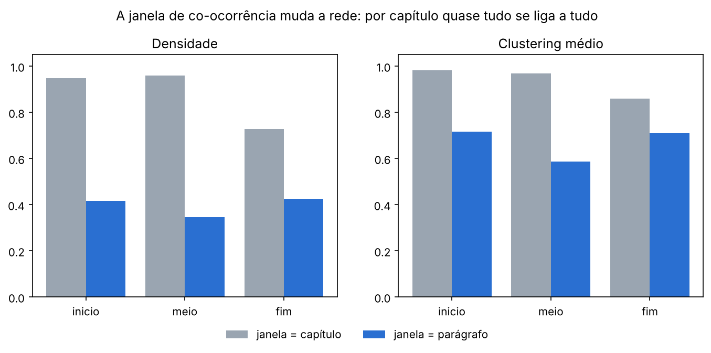
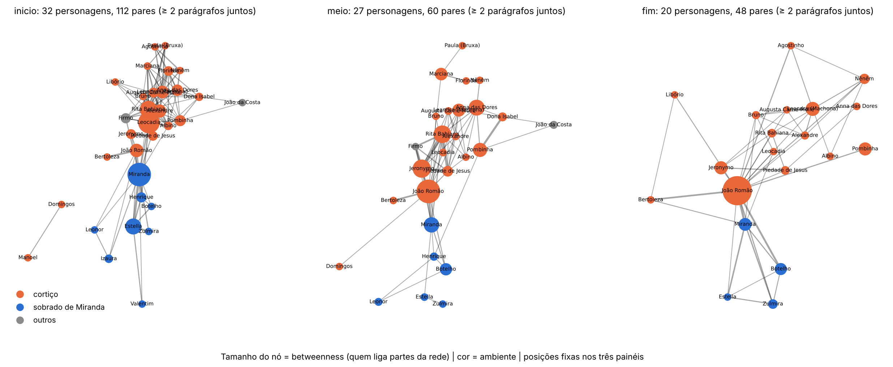
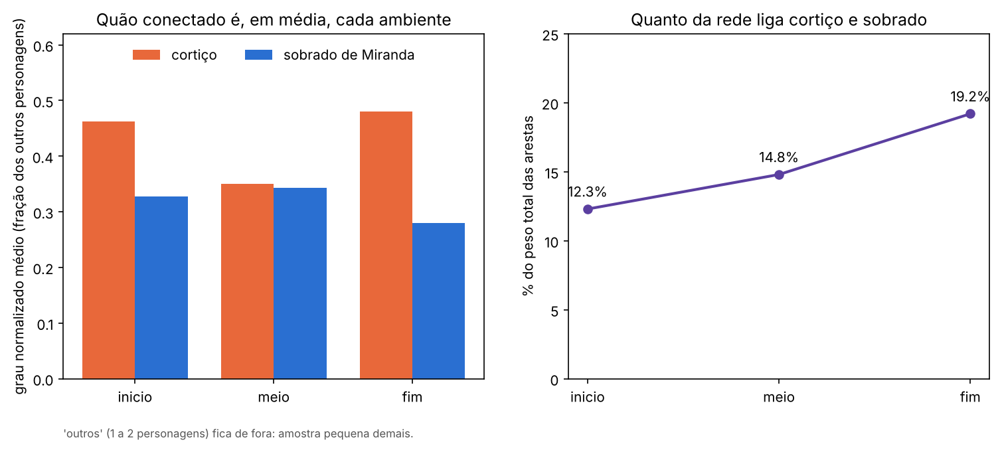
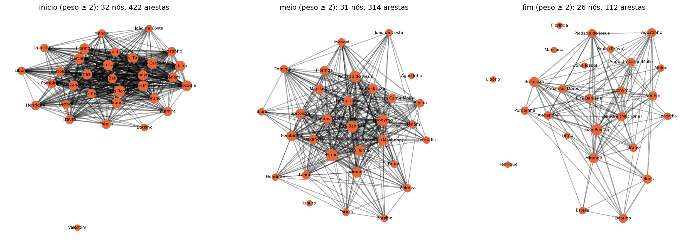

# O ambiente social e a evolução da rede de personagens em *O Cortiço*

## Integrantes

Breno Gustavo de Araujo Dantas | Letícia Cibele Lima do Nascimento | Maria Luiza da Costa Barbosa

## Vídeo
https://youtu.be/yQcaSZUo7Vw

## Problema e pergunta

**Pergunta.** Como a rede de coocorrência de personagens de *O Cortiço* (Aluísio Azevedo, 1890) muda do início ao
meio e ao final do romance, e personagens associados a ambientes sociais diferentes (cortiço, sobrado de Miranda,
outros) ocupam posições diferentes na rede?

**Por que em rede.** A pergunta é sobre relações, não sobre contagem. Quantas vezes um personagem é citado não diz
quem faz a ponte entre o cortiço e o sobrado, nem se os dois mundos se misturam ou ficam separados. Essas são
propriedades da estrutura (caminhos, pontes, grupos coesos, mistura entre atributos), e só existem quando os
personagens são nós e as cenas compartilhadas são arestas.
**Quem se beneficia.** Leitores e professores de literatura brasileira, que ganham uma leitura estrutural do romance
(quem liga os grupos sociais e como isso muda) que complementa a leitura crítica tradicional. O projeto também serve de
exemplo de método: mostra como uma decisão de modelagem (a janela de coocorrência) muda as conclusões.

## Dados

- **Fonte:** https://letrasmais.net.br/lira/index.php?pg=76&post=1012
- **Como obter:** `python src/00_baixar_texto.py`.
- **Limpeza:** cabeçalho/rodapé do Gutenberg e índice ignorados; 23 capítulos separados pelos numerais romanos;
  quebras de linha dentro de parágrafos normalizadas (`src/02_preparar_capitulos.py`).
- **Dicionário de personagens:** feito à mão (`src/personagens.py`), com variantes da ortografia da edição.
- **Ambiente social:** classificado à mão em `data/processed/ambientes.csv`, com capítulo e trecho de evidência.

Critério de classificação: onde o personagem mora ou trabalha, segundo o texto. Cortiço (22): moradores, lavadeiras,
e também João Romão, Bertoleza e os caixeiros da venda, que ficam à entrada da estalagem. Sobrado de Miranda (8):
a família, os hóspedes (Henrique, Botelho) e a criadagem (Izaura, Leonor, Valentim). Outros (2): Firmo e João da
Costa, que aparecem como visitantes ou vêm de fora.

## Modelagem

| Elemento | Definição |
|---|---|
| Nó | Personagem (variantes de nome unificadas no dicionário) |
| Aresta | Dois personagens coocorrem. Duas versões: **capítulo** (aparecem no mesmo capítulo) e **parágrafo** (aparecem no mesmo parágrafo) |
| Peso | Nº de janelas compartilhadas (capítulos ou parágrafos). Na rede por capítulo também o índice de Jaccard, como peso normalizado |
| Direção | Não direcionado (coocorrência é simétrica) |
| Atributos | `ambiente` (cortico, sobrado, outros); `n_cap` / `n_par` (em quantos capítulos / parágrafos aparece) |
| Recortes | Início (caps. I a VIII, 762 parágrafos), meio (IX a XVI, 1.026) e fim (XVII a XXIII, 439), mais a obra completa |

**Qual rede é a principal.** A rede por capítulo é quase um grafo completo (densidade 0,95, diâmetro 2): quase todo
mundo aparece com quase todo mundo, e as métricas quase não distinguem os personagens (no início, oito personagens
empatam em força 125). Por isso a **rede por parágrafo** é a principal para responder à pergunta. A rede por capítulo
fica como comparação e como análise de sensibilidade da janela.

**Por que distância = 1/peso.** Em betweenness e closeness, pares que dividem mais parágrafos ficam "mais perto".
É uma escolha de modelagem; sem ela, toda aresta valeria o mesmo.

**O que ficou de fora:**

- O cortiço como "personagem" e coletivos ("as lavadeiras", "a gentalha").
- Personagens secundários não incluídos no dicionário. Entre os candidatos há nomes que parecem personagens, como
  Léonie, Porfiro, Pataca, Jujú e Zé Carlos (veja `candidatos_a_nome.csv`; não foram verificados um a um).
- Menções por pronome ("ele", "ela"): não há resolução de correferência, então personagens muito referidos por
  pronome têm ligações subestimadas.
- Relações entre personagens que nunca aparecem juntos (ex.: quem só se relaciona por cartas ou por terceiros).
- Nomeação não é presença: ser citado de passagem conta como aparecer.

## Conteúdo do curso utilizado

| conceito | semana | onde aparece | para que serviu |
|---|---|---|---|
| Tipos de grafo (não dirigido, ponderado), nó, aresta, peso | 2 | `src/04_construir_redes.py`; `src/08_paragrafo_e_ambientes.py` (`grafo_paragrafo`, l. 41) | definir o modelo das redes por capítulo e por parágrafo |
| Atributos de nó | 2 | `data/processed/ambientes.csv`; `src/05_calcular_metricas.py` (l. 57); `src/08` (l. 46) | comparar a posição de cada ambiente |
| Rede bipartida (capítulo x personagem), matriz de incidência e projeção | 6 | `data/processed/presenca.csv` (incidência); `src/04_construir_redes.py` (l. 15, `Bp.T @ Bp`) | obter a rede de personagens por capítulo |
| Coocorrência e janela | 6 | `src/08` (l. 41 a 55); `src/07_analises_extras.py` (l. 38 a 52) | construir a rede por parágrafo e medir o efeito da janela |
| Índice de Jaccard | 6 | `src/04_construir_redes.py` (l. 23) | peso normalizado das arestas por capítulo |
| Esqueleto por limiar | 6 | `src/06_gerar_figuras.py` (`JACCARD_MIN`, l. 19); `src/08` (esqueleto Jaccard, l. 127 em diante) | tornar legível a rede por capítulo e ver quando ela se fragmenta |
| Densidade | 2 | `src/05` (l. 40); `src/08` (l. 82) | mostrar que a rede por capítulo é quase completa (0,95) e a por parágrafo não (0,35 a 0,43) |
| Grau (e grau normalizado) | 2 | `src/05` (l. 48); `src/08` (l. 96) | medir quão conectado é cada personagem e cada ambiente |
| Subredes (dentro e entre ambientes) | 2 | `src/05` (l. 70 a 79); `src/08` (l. 100 a 108, `mistura_ambientes_paragrafo.csv`) | medir quanto da rede liga cortiço e sobrado |
| Componentes | 4 | `src/05` (l. 42); `src/08` (l. 84) | ver se a rede se parte (por parágrafo, no meio há 2 componentes) |
| Caminhos e diâmetro | 4 | `src/05` (l. 43); `src/08` (l. 85) | rede pequena: diâmetro 2 (capítulo) e 3 (parágrafo) |
| Eficiência global | 4 | `src/05` (l. 44); `src/08` (l. 86) | medir a facilidade de circulação entre personagens |
| Clustering | 4 | `src/05` (l. 41); `src/08` (l. 83) | medir a formação de grupos fechados (0,86 a 0,98 por capítulo contra 0,59 a 0,72 por parágrafo) |
| Centralidade de grau, closeness e betweenness | 4 | `src/05` (l. 49 a 51); `src/08` (l. 91 a 92) | identificar quem faz a ponte entre grupos (Miranda no início, João Romão depois) |
| k-core, core number e degenerescência | 5 | `src/05` (l. 45 e 50); `src/08` (l. 79 e 87) | medir o núcleo mais coeso da rede em cada fase |

Ferramentas **de fora do curso** (complementares, não substituem as acima): coeficiente de assortatividade por atributo
(`nx.attribute_assortativity_coefficient`, `src/08` l. 60) e teste de permutação com 1.000 sorteios dos ambientes
(`src/08` l. 58 a 70), usados para saber se a separação entre cortiço e sobrado é maior que o acaso. No lugar de NER
(semana 6), usamos um dicionário de personagens feito à mão.


## Como executar

```
python -m venv .venv
.venv\Scripts\activate            # Windows (Linux/macOS: source .venv/bin/activate)
python -m pip install -r requirements.txt
python src/run_all.py
```

Resultados em `data/processed/` e `results/` (tabelas e figuras).

## Resultados

Janela por parágrafo, 23 capítulos, 32 personagens. Os números abaixo estão em `results/tabelas/`.

**1. A janela de coocorrência muda a rede.** Por capítulo, quase tudo se liga a tudo (obra completa: densidade 0,95;
clustering 0,99; 472 arestas). Por parágrafo, a densidade cai para 0,59 na obra completa (294 arestas) e fica entre 0,35 e 0,43 nas
três fases. A aresta mais pesada é a mesma nas duas janelas (João Romão e Miranda: 16 capítulos, 24 parágrafos).



**2. Cortiço e sobrado formam grupos distintos, em todas as fases.** O coeficiente de assortatividade por ambiente fica
em torno de 0,3 (0,315 no início, 0,295 no meio e 0,300 no fim). Nenhuma das 1.000 permutações aleatórias de ambientes igualou esses
valores (p ≈ 0,001, o mínimo possível com 1.000 sorteios): quem é do mesmo ambiente coocorre mais do que o acaso
explicaria. Entre 62% e 70% do peso das arestas liga dois personagens do cortiço, e só 9% a 14% liga dois do sobrado.

**3. Os dois mundos se aproximam ao longo do romance.** A fatia do peso total que liga cortiço e sobrado cresce:
12,3% no início, 14,8% no meio e 19,2% no fim.

| período | personagens | arestas | densidade | clustering | componentes | assortatividade | cortiço-sobrado (% do peso) |
|---|---|---|---|---|---|---|---|
| início | 32 | 207 | 0,417 | 0,716 | 1 | 0,315 | 12,3 |
| meio | 31 | 161 | 0,346 | 0,587 | 2 | 0,295 | 14,8 |
| fim | 26 | 138 | 0,425 | 0,710 | 1 | 0,300 | 19,2 |

**4. Quem liga os grupos muda.** Pelo betweenness (distância 1/peso), o maior ponto de passagem no início é Miranda
(0,38, do sobrado), no meio é João Romão (0,39) e no fim João Romão de novo, agora com 0,61, o valor mais alto de
qualquer personagem em qualquer fase. Miranda cai para 0,08 no fim, embora continue o segundo em força (41). Em força
(parágrafos compartilhados), João Romão é o 1º no fim (65). Isso é compatível com a trama (a ascensão de João Romão e sua
aproximação do sobrado), mas a rede sozinha não prova essa interpretação.



**5. Posição por ambiente.** O cortiço tem grau normalizado médio maior no início (0,46 contra 0,33) e no fim (0,48
contra 0,28), mas no meio os dois ambientes quase empatam (0,35 e 0,34). "Outros" tem 2, 2 e 1 personagens nas três
fases, pouco para interpretar, e ficou fora das comparações.



**6. As ausências contam a cronologia.** Os personagens do sobrado entram nos capítulos I e II; as lavadeiras e a
vizinhança do cortiço entram em bloco no capítulo III; Jeronymo e Piedade chegam nos capítulos IV e V
(`results/tabelas/capitulo_de_entrada.csv`). No fim, seis personagens somem da rede (Domingos, Manoel, Izaura,
Leonor, Valentim e João da Costa), e a rede por capítulo é a única fase em que deixa de ser quase completa (0,73).

**7. Esqueleto por Jaccard (rede por capítulo).** Com o corte em 0,6, o sobrado se separa visivelmente do cortiço e,
no fim, a rede se parte em 3 componentes (`results/tabelas/esqueleto_jaccard.csv`).



## Limitações e próximos passos

**Limitações**

- Coocorrência não é interação: dois personagens no mesmo parágrafo não necessariamente se encontram ou conversam,
  e um parágrafo curto de diálogo pesa o mesmo que uma cena longa.
- Dicionário manual de 32 personagens. Há candidatos a personagem fora dele (ver "O que ficou de fora"), e a falta de
  correferência subestima ligações de quem é citado por pronome. Os resultados valem para este conjunto de 32.
- Só 273 dos 2.227 parágrafos têm dois ou mais personagens do dicionário, então a rede por parágrafo é construída
  sobre poucas cenas.
- Os períodos têm tamanhos desiguais (762, 1.026 e 439 parágrafos). Compare densidade e arestas entre fases com
  cuidado; por isso usamos medidas normalizadas (grau normalizado) nas comparações entre ambientes.
- O ambiente é fixo por personagem (onde mora ou trabalha). Quem circula entre os mundos, como Izaura e Leonor,
  que frequentam a venda, aparece só em um deles. O grupo "outros" é pequeno demais para conclusões.
- A distância 1/peso e o limiar de Jaccard (0,6) e de peso (2) nas figuras são escolhas nossas; outros valores mudam
  os números (por isso a tabela de sensibilidade em `esqueleto_jaccard.csv`).
- A leitura literária (ex.: ascensão de João Romão) é consistente com os números, mas estes são descritivos, não
  provam causa. Com cerca de 30 nós, o custo computacional é desprezível; um livro com centenas de personagens
  exigiria rever o cálculo de betweenness.

**Próximos passos**

- Acrescentar os personagens secundários que faltam e classificar seus ambientes.
- Substituir o dicionário por NER com resolução de correferência.
- Testar janelas deslizantes (ex.: 3 ou 5 parágrafos) e rede capítulo a capítulo, em vez de três fases.
- Detectar comunidades (fora do curso) e comparar com a classificação manual de ambientes.
- Repetir o método em outra obra para ver se a aproximação entre mundos sociais é característica do romance.
## Referências

- Azevedo, A. *O Cortiço*. Project Gutenberg #69187.
- Material da disciplina: lesson08 (Do texto à rede) e Projeto_Avaliacao_1.
